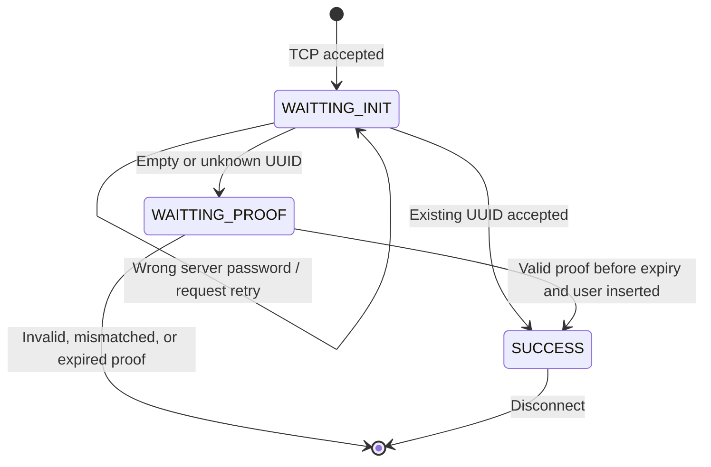
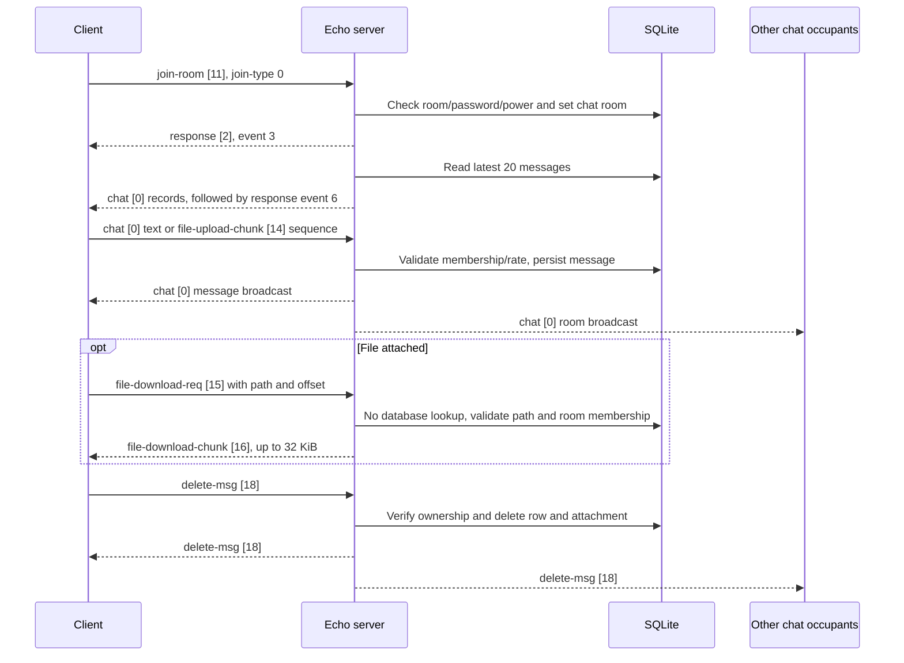

# Echo Server API and Protocol Reference

This document describes the API accepted and emitted by the Echo server. The
ASN.1 source of truth is [`ChatProtocol.asn`](../ChatProtocol.asn); the client
contains a matching copy. There is no protocol version negotiation.

## Service architecture

| Channel | Responsibility | Default port |
|---|---|---:|
| TCP | Authentication, room membership, chat, roles, profiles, and file transfer | 5555 |
| UDP | Opus voice peer registration and audio fan-out | 5555/UDP |

TCP frames contain a two-byte big-endian DER payload length, followed by the
ASN.1 DER payload. The maximum length expressible by the prefix is 65,535
bytes. Client and server exchange large files as chunks. The server's TCP
listener is plain `QTcpServer`; direct TLS termination is not implemented.
Deployments needing TLS must terminate TLS in a proxy that forwards the
application protocol.

The TCP socket handlers and SQLite queries run on the server's Qt event-loop
thread. The UDP voice socket runs on a dedicated worker thread. Voice access
state is shared with TCP handlers through a mutex-protected authorization
table.

## Event diagrams

### TCP connection and authentication

### Room chat and file delivery

Voice join is authorized over TCP (`join-room`, type `1`); audio and voice
state then travel over UDP. Chat and voice membership are independent.

## ASN.1 message API

Each framed TCP payload is one `ProtocolMessage` `CHOICE`. Field spellings
below match `ChatProtocol.asn`; `OPTIONAL` means the ASN.1 field may be absent.

| Tag | Alternative | Direction | ASN.1 fields |
|---:|---|---|---|
| 0 | `chat` | Client ↔ server | `room-id INTEGER`, `msg-id INTEGER`, `sender-id INTEGER`, `sender UTF8String`, `sender-avatar UTF8String`, `content UTF8String`, `msg-type INTEGER`, `timestamp INTEGER` |
| 1 | `system` | Server → client (schema only) | `cpu-load INTEGER`, `uptime INTEGER` |
| 2 | `response` | Server → client | `event INTEGER`, `status INTEGER`, `message UTF8String OPTIONAL` |
| 3 | `client-check-id` | Client → server | `uuid UTF8String`, `name UTF8String`, `password UTF8String OPTIONAL` |
| 4 | `new-user-challenge` | Server → client | `uuid UTF8String`, `challenge OCTET STRING`, `difficulty INTEGER` |
| 5 | `new-user-proof` | Client → server | `uuid UTF8String`, `solution INTEGER` |
| 6 | `claim-admin-privilege` | Client → server | `key UTF8String` |
| 7 | `member_list` | Server → client | `SEQUENCE OF { id INTEGER, name UTF8String, avatar UTF8String, is-online BOOLEAN OPTIONAL, is-admin BOOLEAN OPTIONAL }` |
| 8 | `member_detail` | Server → client | `id INTEGER`, `name UTF8String`, `avatar UTF8String`, `created-at INTEGER`, `last-seen INTEGER`, `status INTEGER`, `roles UTF8String OPTIONAL` |
| 9 | `room_list` | Server → client | `SEQUENCE OF { id INTEGER, name UTF8String, users-in-voice-room SEQUENCE OF { id INTEGER, name UTF8String, avatar UTF8String, is-mute BOOLEAN, is-deaf BOOLEAN } OPTIONAL, has-password BOOLEAN OPTIONAL, needed-voice-join-power INTEGER OPTIONAL, needed-chat-join-power INTEGER OPTIONAL, needed-speak-power INTEGER OPTIONAL }` |
| 10 | `create-room` | Client → server | `name UTF8String`, `password UTF8String`, `limit-clients INTEGER`, `needed-voice-join-power INTEGER`, `needed-chat-join-power INTEGER`, `needed-speak-power INTEGER` |
| 11 | `join-room` | Client → server | `room-id INTEGER`, `password UTF8String OPTIONAL`, `join-type INTEGER OPTIONAL` |
| 12 | `update-server-settings` | Client → server | `server-name UTF8String`, `server-password UTF8String` |
| 13 | `leave-room` | Client → server | `room-id INTEGER`, `leave-type INTEGER OPTIONAL` |
| 14 | `file-upload-chunk` | Client → server | `upload-id UTF8String`, `room-id INTEGER`, `file-name UTF8String`, `total-size INTEGER`, `offset INTEGER`, `msg-type INTEGER`, `data OCTET STRING` |
| 15 | `file-download-req` | Client → server | `room-id INTEGER`, `file-path UTF8String`, `offset INTEGER` |
| 16 | `file-download-chunk` | Server → client | `room-id INTEGER`, `file-path UTF8String`, `total-size INTEGER`, `offset INTEGER`, `data OCTET STRING` |
| 17 | `history-req` | Client → server | `room-id INTEGER`, `before-id INTEGER`, `limit INTEGER` |
| 18 | `delete-msg` | Client → server request; server → room broadcast | `room-id INTEGER`, `msg-id INTEGER` |
| 19 | `get-my-info` | Client → server | `dummy INTEGER OPTIONAL` |
| 20 | `my-info` | Server → client | `id INTEGER`, `uuid UTF8String`, `name UTF8String`, `avatar UTF8String`, `created-at INTEGER`, `server-uptime INTEGER` |
| 21 | `avatar-upload-chunk` | Client → server | `upload-id UTF8String`, `file-name UTF8String`, `total-size INTEGER`, `offset INTEGER`, `data OCTET STRING` |
| 22 | `get-roles-req` | Client → server | `dummy INTEGER OPTIONAL` |
| 23 | `role-list` | Server → client | `SEQUENCE OF { id INTEGER, name UTF8String, permissions UTF8String }` |
| 24 | `create-role` | Client → server | `name UTF8String` |
| 25 | `update-role-perms` | Client → server | `role-id INTEGER`, `permissions UTF8String` |
| 26 | `delete-role` | Client → server | `role-id INTEGER` |
| 27 | `get-user-roles-req` | Client → server | `user-id INTEGER` |
| 28 | `user-roles-list` | Server → client | `user-id INTEGER`, `roles-json UTF8String` |
| 29 | `assign-user-roles` | Client → server | `user-id INTEGER`, `role-ids UTF8String` |
| 30 | `kick-user` | Client → server | `user-id INTEGER`, `room-id INTEGER OPTIONAL` |
| 31 | `update-room` | Client → server | `room-id INTEGER`, `name UTF8String`, `password UTF8String`, `needed-voice-join-power INTEGER`, `needed-chat-join-power INTEGER`, `needed-speak-power INTEGER` |
| 32 | `poke-user` | Client → server | `target-user-id INTEGER`, `message UTF8String OPTIONAL` |
| 33 | `get-members-req` | Client → server | `dummy INTEGER OPTIONAL` |
| 34 | `get-member-detail-req` | Client → server | `user-id INTEGER` |

## Authentication and connection state

Every accepted TCP socket starts in `WAITTING_INIT`. Only `client-check-id`
should be sent in this state.

1. If a configured server password is non-empty, the submitted password must
   match. The server responds with response event `0`, status `401` on failure;
   the connection remains available for another check.
2. For a known UUID, the server updates the user's display name, authenticates
   the socket, returns response event `0` with status `200`, then sends
   `room_list`.
3. For an empty or unknown UUID, the server generates a UUID, a 32-byte
   challenge, difficulty `16`, and a 30-second expiry. State becomes
   `WAITTING_PROOF`.
4. The proof is SHA-256 over
   `UTF8(uuid) || challenge || ASCII(decimal(solution))`. Difficulty means the
   first 16 hash bits are zero. Valid proof inserts the user, changes state to
   `SUCCESS`, responds with event `0`, and sends `room_list`. Invalid, expired,
   or mismatched proof is rejected and the socket disconnected.

Success response metadata for existing users is
`"<id>:<avatar-path>:<server-name>:<is-admin>:<can-kick>"`. New-user metadata
is `"<id>::<server-name>:0:<can-kick>"`. The client parses this positional
colon-delimited string.

## Request behavior and authorization

| Request | Server handler / response | Current behavior |
|---|---|---|
| `chat` [0] | `handle_chat_message`; broadcasts `chat` [0] | Requires authenticated socket and current chat room match. Server uses socket identity, stores UTF-8 text, assigns ID/time, broadcasts only to authenticated chat occupants. Rate limit: 5 messages in 2 seconds, then 5-second timeout. |
| `client-check-id` [3] | `check_user_id`; response event 0 / challenge [4] | Valid only in `WAITTING_INIT`; checks configured server password and starts known/new user flow. |
| `new-user-proof` [5] | `check_new_user_proof`; response event 0 | Valid only in `WAITTING_PROOF`, matching pending UUID and before expiry. |
| `claim-admin-privilege` [6] | `claim_admin_privilege`; response event 1 and event 16 | Matches one-time `initial_admin_token`, grants admin, clears the token, and refreshes permissions. |
| `create-room` [10] | `handle_create_room`; response event 2 | Requires admin or `u_can_create_rooms`; stores room name, password, limit, and three power thresholds; broadcasts updated room list. |
| `join-room` [11] | `handle_join_room`; response event 3 | Validates room and password. Type `0` checks chat-join power, sets chat room, and sends 20 history messages. Type `1` checks voice-join power, replaces prior voice room, sets voice authorization/speak permission, and broadcasts room list. |
| `update-server-settings` [12] | `handle_update_server_settings`; response event 4 | Admin only. Empty name/password leaves that setting unchanged; password `"__CLEAR__"` clears password. Success response is broadcast to authenticated users with current server name. |
| `leave-room` [13] | `handle_leave_room` | `leave-type = 0` clears matching chat membership; `1` clears voice membership and broadcasts room list. |
| `file-upload-chunk` [14] | `handle_file_upload_chunk`; response event 5 | Requires authenticated user and chat membership in supplied room. Maximum 10 MiB. After final chunk, persists file under `files/room/<room-id>/`, stores message row, broadcasts attachment `chat`, then responds with path. |
| `file-download-req` [15] | `handle_file_download_req`; chunk [16] | Allows paths under `files/room/` or `files/avt/`, rejects `..`. Room files require current chat membership for the requested room. Returns at most 32 KiB from offset; invalid paths/missing files/out-of-range offsets are silently ignored by current handler. |
| `history-req` [17] | `handle_history_req`; chat [0] records + response event 6 | Requires authenticated user and that requested room is the current chat room. `before-id = 0` gets latest page; otherwise IDs `< before-id`. Limit outside `1..50` becomes 20. Page order is chronological. |
| `delete-msg` [18] | `handle_delete_msg`; delete broadcast [18] or response event 7 | Requires authenticated user and message ownership. Deletes row and attachment file, then broadcasts to current occupants of supplied chat room. Current handler does not additionally require the requester to be a member of that chat room. |
| `get-my-info` [19] | `handle_get_my_info`; `my-info` [20] | Returns the authenticated user's UUID, name, avatar path, creation time, and server uptime in seconds. |
| `avatar-upload-chunk` [21] | `handle_avatar_upload_chunk`; response event 8 | Authenticated users only; max 2 MiB. Validates extension and file signature for PNG, JPEG, GIF, BMP, WEBP, and AVIF; replaces prior avatar file and updates the user record. |
| `get-roles-req` [22] | `handle_get_roles`; `role-list` [23] | Authenticated users receive role IDs, names, and permission mappings as compact JSON objects. |
| `create-role` [24] | `handle_create_role`; response event 9 and `role-list` [23] | Admin only; creates role with zero-valued permissions initially. |
| `update-role-perms` [25] | `handle_update_role_perms`; response event 10, event 16 | Admin only. `permissions` must be a JSON object; keys map to known permission names and values are integers. Rechecks active room access/speak permissions. |
| `delete-role` [26] | `handle_delete_role`; response event 11 and `role-list` [23] | Admin only; deletes role (DB cascade removes assignments), then rechecks active permissions. |
| `get-user-roles-req` [27] | `handle_get_user_roles`; `user-roles-list` [28] | Admin only. Returns a JSON array of every role with its assigned flag. Non-admin requests receive no response. |
| `assign-user-roles` [29] | `handle_assign_user_roles`; response event 12 and event 16 | Admin only. Replaces all assignments for target user from comma-separated role IDs, updates that user's admin/kick flags, then rechecks active permissions. |
| `kick-user` [30] | `handle_kick_user`; response event 13 and event 15 | Admin or `u_can_kick_users`. Despite the optional `room-id`, current handler only removes target from voice; it does not disconnect them or remove chat membership. |
| `update-room` [31] | `handle_update_room`; response event 14 | Admin or `u_can_create_rooms`. Updates room fields and power thresholds. A non-empty new password forces current chat and voice occupants to reauthenticate. |
| `poke-user` [32] | `handle_poke_user`; response events 17/18 | Authenticated user may poke an online user other than self. Sender cooldown is 5 seconds. |
| `get-members-req` [33] | `handle_get_members`; `member_list` [7] | Authenticated users receive all registered members, naturally sorted, with online/admin flags. |
| `get-member-detail-req` [34] | `handle_get_member_detail`; `member_detail` [8] | Authenticated users receive member profile and role names. Missing/zero ID receives no response. |

### Permission model

Effective user permission value is the maximum value among their assigned
roles; database permissions are:

| Permission | Meaning |
|---|---|
| `u_can_create_rooms` | Boolean-style permission; also authorizes room updates |
| `u_can_delete_rooms` | Defined in schema/default roles; no delete-room protocol handler is registered |
| `u_can_ban_users` | Defined in schema/default roles; no ban protocol handler is registered |
| `u_can_kick_users` | Allows kicking a user from voice |
| `u_voice_join_power` | Required to join voice room |
| `u_chat_join_power` | Required to join chat room |
| `u_speak_power` | Required to transmit voice in the current room |

Admins bypass power checks. Role/permission changes trigger active membership
rechecks: users may be removed from chat/voice if join power falls below the
room requirement; voice send permission is updated without requiring a rejoin.

## Generic response events

`response` tag `[2]` contains an event ID, status, and optional UTF-8 message.
Status constants are `SUCCESS = 200`, `ERROR = 400`, `PASSWORD_REQUIRED = 401`,
and `FAILED = 500`. `ERROR` is defined but is not the normal server failure
status.

| Event | Name | Usage |
|---:|---|---|
| 0 | `RESPONSE_USER_CHECK_ID` | Login/registration result; positional colon-delimited identity metadata on success. |
| 1 | `RESPONSE_USER_CLAIM_ADMIN_PRIVILEGE` | Admin claim result. |
| 2 | `RESPONSE_CREATE_ROOM` | Room creation result. |
| 3 | `RESPONSE_JOIN_ROOM` | Success message `"<room-id>:<join-type>"`; password error starts `"<room-id>:<join-type>:..."`. |
| 4 | `RESPONSE_UPDATE_SERVER_SETTINGS` | Server settings result; success message is current server name. |
| 5 | `RESPONSE_FILE_UPLOAD` | Upload completion/error; success message is stored path. |
| 6 | `RESPONSE_HISTORY` | History terminator `"<room-id>:<count>"`. |
| 7 | `RESPONSE_DELETE_MSG` | Delete error; successful delete uses tag `[18]` broadcast. |
| 8 | `RESPONSE_AVATAR_UPLOAD` | Avatar upload result; success message is stored path. |
| 9 | `RESPONSE_CREATE_ROLE` | Role creation result; success message is role ID. |
| 10 | `RESPONSE_UPDATE_ROLE_PERMS` | Role permission update result. |
| 11 | `RESPONSE_DELETE_ROLE` | Role deletion result. |
| 12 | `RESPONSE_ASSIGN_USER_ROLES` | Role assignment result. |
| 13 | `RESPONSE_KICK_USER` | Kick action result. |
| 14 | `RESPONSE_UPDATE_ROOM` | Room update result. |
| 15 | `RESPONSE_KICKED` | Access revoked; message prefix `chat:<room-id>:` means chat, `voice:` means voice. |
| 16 | `RESPONSE_PERMS_UPDATED` | Message `"<is-admin>:<can-kick>"`, booleans encoded as `0` or `1`. |
| 17 | `RESPONSE_POKE_USER` | Poke sender result. |
| 18 | `RESPONSE_POKED` | Incoming poke; `"<sender-name>:<sender-id>:<message>"`. |
| 19 | `RESPONSE_CHAT` | Text chat rejection, e.g. rate limit. |

## File storage and message representation

- Text rows store UTF-8 message text in `messages.payload`.
- Attachment rows store the relative path (UTF-8) in `messages.payload`; the
  same path is broadcast in `chat.content`.
- Room attachments are stored in `files/room/<room-id>/<filename>`; duplicate
  filenames receive a numbered suffix.
- Avatar files are stored under `files/avt/`.
- Chat upload size limit is 10 MiB, avatar limit is 2 MiB, and file transfer
  chunk size is 32 KiB.
- Message deletion removes the database row and, for attachment message types,
  attempts to unlink the associated room file.

## UDP voice protocol

Voice packets are a packed 29-byte C++ struct followed by optional Opus data.
The current implementation transmits the native struct directly without
network-byte-order conversion. Current supported Windows clients are
little-endian; third-party implementations must match this byte representation
unless the protocol is revised.

| Offset | Size | Field |
|---:|---:|---|
| 0 | 4 | `magic` = `0x4543484F` |
| 4 | 1 | `packet_type` |
| 5 | 8 | `user_id` |
| 13 | 8 | `room_id` |
| 21 | 4 | `seq` |
| 25 | 1 | `is_mute` |
| 26 | 1 | `is_deaf` |
| 27 | 2 | `payload_size` |

Packet type values are `VOICE_PING = 1`, `VOICE_DATA = 2`, `VOICE_LEAVE = 3`,
and `VOICE_STATE = 4`. The server verifies header size, magic, payload size,
packet type, and that the authenticated user is authorized in the stated
voice room. Opus payloads must be non-empty and no larger than 1200 bytes.
Muted or non-speaking users' audio is dropped. Audio is routed to other
recently active members in that room, excluding deafened recipients.

The client uses Opus mono at 48 kHz, with 10 ms audio frames and a configurable
16–128 kbps bitrate (default 40 kbps); voice ping is sent every 2 seconds.

## Current implementation caveats

- ASN.1 tag `[1]` (`system`) is defined but no server handler currently emits
  CPU or uptime telemetry through it.
- The configured `limit-clients` value is stored for rooms but is not enforced
  by the current join handler.
- `member_detail.last-seen` currently carries the admin flag (`0`/`1`), and
  `member_detail.status` currently carries online state (`0`/`1`). A real
  last-seen timestamp is not serialized by the current handler.
- Successful message deletion is a tag `[18]` broadcast rather than a
  `RESPONSE_DELETE_MSG` success event.
- `kick-user.room-id` is accepted by the schema but the current handler only
  removes the target from voice, even when chat membership exists.
- `file-download-req` failures (invalid path, missing file, or offset outside
  the file) currently return without an explicit error packet.
